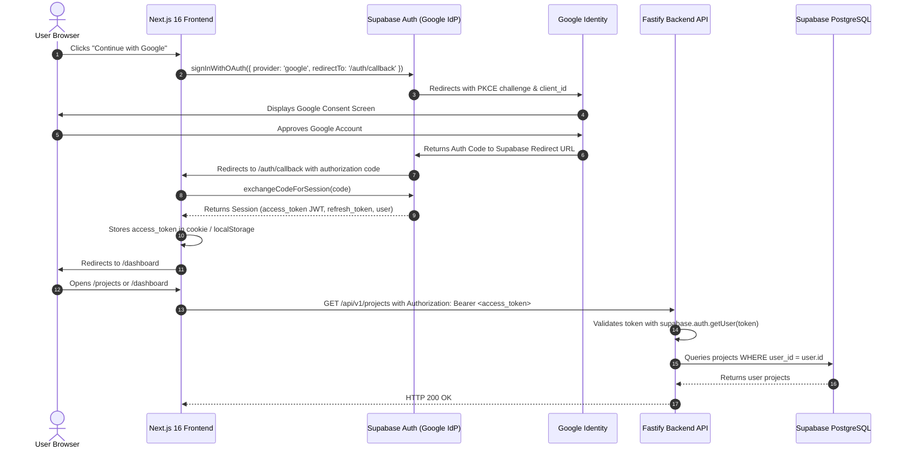

# SiteScope — Authentication Audit & Google Login Migration Plan

**Repository**: `H:\analytics-based-platform`  
**Current State**: Dev bypass stub (`dev-token`) with mock frontend forms (`setTimeout`)  
**Target State**: **Google Login Only** (Seamless OAuth 2.0 / PKCE Flow with Supabase Auth or Google OAuth Identity)  

---

## 1. Audit of Existing Authentication System

### A. Frontend Implementation (`frontend/src/app/login/`, `register/`, `lib/api.ts`)
- **Login Form (`frontend/src/app/login/page.tsx`)**:
  - Contains Email and Password `<input>` elements.
  - On submit (`handleLogin`), it does NOT execute an API call or contact Supabase Auth.
  - Hardcoded code:
    ```typescript
    setTimeout(() => {
      setIsLoading(false);
      window.location.href = '/dashboard';
    }, 1000);
    ```
- **Registration Form (`frontend/src/app/register/page.tsx`)**:
  - Contains Name, Email, and Password inputs.
  - On submit, similarly executes a mock 1-second timeout and redirects to `/dashboard`.
- **Token Management (`frontend/src/lib/api.ts`)**:
  - Reads token from `localStorage.getItem('sitescope_auth_token') || 'dev-token'`.
  - Sends `Authorization: Bearer dev-token` on every outgoing HTTP request.
- **Protected Routes / Middleware**:
  - There is no `middleware.ts` in `frontend/src/` guarding `/dashboard`, `/projects`, or `/billing`. Any user or browser can directly navigate to `/dashboard` without an authenticated session.

### B. Backend Implementation (`backend/src/middleware/auth.ts`)
- Inspects `request.headers.authorization`.
- Contains a local development bypass:
  ```typescript
  const isDev = process.env.NODE_ENV !== 'production';
  const isPlaceholder = !process.env.SUPABASE_URL || process.env.SUPABASE_URL.includes('placeholder');
  if (isDev && (token === 'dev-token' || isPlaceholder)) {
    (request as any).user = {
      id: '00000000-0000-0000-0000-000000000001',
      email: 'dev@sitescope.io',
    };
    return;
  }
  ```
- If `SUPABASE_URL` is configured, it calls `supabase.auth.getUser(token)`.
- It expects a Supabase Auth JWT token and attaches `req.user = { id: user.id, email: user.email }`.

### C. Database Dependencies
- 14 PostgreSQL tables reference `auth.users(id)`:
  - `projects.user_id`
  - `audit_jobs.user_id`
  - `issue_states.user_id`
  - `analytics_connections.user_id`
  - `subscriptions.user_id`
  - `payments.user_id`
  - `billing_invoices.user_id`
  - `usage_ledger.user_id`
  - `reports.user_id`
  - `scheduled_audits.user_id`
  - `notifications.user_id`
  - `idempotency_keys.user_id`
  - `admin_audit_logs.user_id`
  - `billing_audit_logs.user_id`
- 19 RLS policies enforce `auth.uid() = user_id`.

---

## 2. Target Architecture: Google Login Only

The user requirement mandates:
> **"The desired final authentication experience is Google Login only. The existing email/password login and registration experience must be removed or replaced, including any related UI, routes and obsolete flows that are no longer required."**

### Why Supabase Auth + Google Provider is the Optimal Path:
1. **Zero Database Schema Changes**: The existing database schema is already built around Supabase Auth (`auth.users(id)` and `auth.uid()`). Switching to Supabase Auth with Google Provider preserves all 25 tables, 19 RLS policies, and stored procedures without any DDL modifications.
2. **PKCE Security**: `@supabase/ssr` supports modern OAuth 2.0 Authorization Code Flow with PKCE (Proof Key for Code Exchange), which is OWASP-recommended and prevents token interception.
3. **Google Identity Security**: Enforces verified Google email addresses, automated token refresh, and safe session storage.

---

## 3. Step-by-Step Migration Plan



### Phase A: Prerequisites & Provider Configuration (Project Owner Actions)
1. **Google Cloud Console**:
   - Create a Google Cloud Project (or use existing).
   - Configure **OAuth Consent Screen** (User Type: External, App Name: SiteScope).
   - Add Authorized Domain: `supabase.co` and `sitescope.io`.
   - Create **OAuth 2.0 Client ID** (Web application).
   - Set Authorized Redirect URI:
     `https://<your-supabase-project-ref>.supabase.co/auth/v1/callback`
   - Copy `Client ID` and `Client Secret`.
2. **Supabase Dashboard**:
   - Navigate to **Authentication -> Providers -> Google**.
   - Enable Google provider.
   - Enter `Google Client ID` and `Google Client Secret`.
   - Under **Authentication -> URL Configuration**:
     - Site URL: `https://sitescope.io` (or `http://localhost:3000` for local testing).
     - Redirect URLs: `http://localhost:3000/auth/callback`, `https://sitescope.io/auth/callback`.
   - Disable **Email Provider** (uncheck "Enable Email provider" in Supabase Auth to completely block email/password signups).

### Phase B: Frontend Changes
1. **Create Supabase Client Helper (`frontend/src/lib/supabase.ts`)**:
   - Initialize `@supabase/ssr` browser and server clients with `NEXT_PUBLIC_SUPABASE_URL` and `NEXT_PUBLIC_SUPABASE_ANON_KEY`.
2. **Replace `/login` and `/register` with Unified Google Login Page**:
   - Replace the legacy email/password form in `frontend/src/app/login/page.tsx` with a single, elegant "Continue with Google" button with Google's official brand styling.
   - Redirect `/register` to `/login` or render the same unified Google authentication card.
   - Remove password input fields, "Forgot password?" links, and legacy form handlers.
3. **Implement Auth Callback Route (`frontend/src/app/auth/callback/route.ts`)**:
   - Next.js route handler that receives the PKCE `code` from Google OAuth redirect.
   - Calls `supabase.auth.exchangeCodeForSession(code)`.
   - Stores session and redirects user smoothly to `/dashboard`.
4. **Implement Global Route Protection (`frontend/src/middleware.ts`)**:
   - Inspects session on protected routes (`/dashboard`, `/projects`, `/audits`, `/billing`).
   - If unauthenticated, redirects to `/login`.
5. **Update Navbar & Sign Out Handler**:
   - Update `Navbar.tsx` to show "Sign In" when logged out, or User Profile & "Sign Out" button when logged in.
   - Add `handleSignOut` that calls `supabase.auth.signOut()` and clears tokens.
6. **Update API Client (`frontend/src/lib/api.ts`)**:
   - Dynamically retrieve the current access token from the active Supabase session instead of relying on static `'dev-token'`.

### Phase C: Backend Changes
1. **Enforce Real JWT Verification in `backend/src/middleware/auth.ts`**:
   - Verify incoming Bearer token using `supabase.auth.getUser(token)`.
   - Retire the `'dev-token'` hardcoded bypass in staging/production environments.
   - Ensure `req.user.id` is reliably mapped to the verified Supabase Auth UUID.

### Phase D: Testing & Verification Matrix
1. **Successful Google Login**: User logs in via Google popup/redirect, is redirected to `/dashboard`, user profile appears, and API calls carry valid JWT.
2. **Cancelled Google Login**: User cancels Google consent screen -> Cleanly redirected back to `/login` with an informational message.
3. **Session Expiry & Refresh**: Ensure token auto-refreshes seamlessly via Supabase SDK.
4. **Sign Out**: User clicks "Sign Out" -> Session cleared, redirected to `/login`, and subsequent API requests return 401.
5. **Unauthorized Direct Access**: Attempting to load `/dashboard` or `/projects` directly without login redirects to `/login`.
