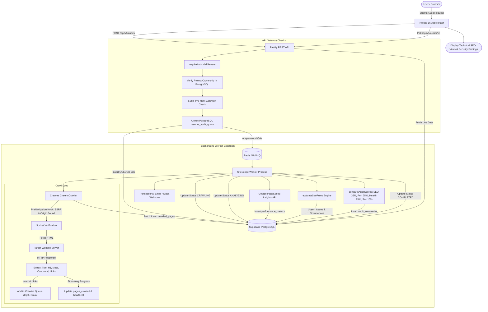

# SiteScope — End-to-End Crawler Lifecycle & Architecture

## 1. System Architecture Flow

---

## 2. Step-by-Step Internal Workflow & Code Reference

| Step | Operation | Responsible File / Function | Target System |
| :--- | :--- | :--- | :--- |
| **1** | Project Selection | `frontend/src/app/audits/page.tsx` | Next.js Client State |
| **2** | Audit Submission | `frontend/src/lib/api.ts` -> `triggerAudit()` | HTTP POST |
| **3** | Authentication & Tenant Check | `backend/src/middleware/auth.ts` -> `requireAuth` | Fastify / Supabase Auth |
| **4** | Target URL Validation | `backend/src/routes/audits.ts` (Zod `CreateAuditSchema`) | Fastify Input Validation |
| **5** | Centralized SSRF Check | `backend/src/services/ssrf.ts` -> `validateTargetUrl()` | DNS & Subnet Filter |
| **6** | Atomic Quota Reservation | `backend/src/routes/audits.ts` -> `supabase.rpc('reserve_audit_quota')` | PostgreSQL Atomic Function |
| **7** | Job Enqueueing | `backend/src/services/queue.ts` -> `enqueueAuditJob()` | BullMQ (`audit-queue`) |
| **8** | Worker Ingestion | `worker/src/index.ts` -> `auditWorker` | BullMQ Event Loop |
| **9** | Crawl Execution | `worker/src/crawlers/cheerio.ts` -> `crawlWebsite()` | Crawlee `CheerioCrawler` |
| **10** | Metadata & Header Extraction | `worker/src/crawlers/cheerio.ts` (`requestHandler`) | In-memory Cheerio DOM |
| **11** | Internal Link Enqueueing | `worker/src/crawlers/cheerio.ts` (`addRequests`) | Crawlee RequestQueue |
| **12** | External Link Recording | `worker/src/crawlers/cheerio.ts` (`page.links`) | Discovered Links Array |
| **13** | SEO & Health Rules | `worker/src/processors/seo-rules.ts` -> `evaluateSeoRules()` | Rule Violation Evaluator |
| **14** | Performance Auditing | `worker/src/services/pagespeed.ts` -> `fetchPageSpeedMetrics()` | Google PSI v5 REST API |
| **15** | Security Verification | `worker/src/processors/seo-rules.ts` (HTTPS, Link, Header checks) | Passive Security Evaluator |
| **16** | Persistence | `worker/src/index.ts` (`crawled_pages`, `issues`, `performance_metrics`) | PostgreSQL Batched Upserts |
| **17** | Scoring & Summary | `worker/src/processors/scoring.ts` -> `computeAuditScores()` | Mathematical Weighted Score |
| **18** | Job Completion & Heartbeat | `worker/src/index.ts` (`audit_jobs.status = 'COMPLETED'`) | PostgreSQL Final State |
| **19** | User Visualization | `frontend/src/app/audits/[auditId]/page.tsx` | Next.js Dashboard UI |
