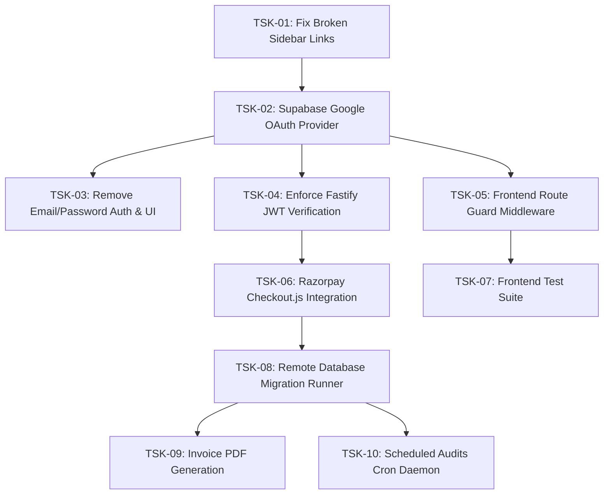

# SiteScope — Prioritized Implementation Roadmap

**Repository**: `H:\analytics-based-platform`  
**Current Phase**: Audit Complete (Phase 0)  
**Execution Guideline**: Strictly sequenced tasks prioritized by data security, architecture blockers, authentication, payment, and UI fixes.  

---

## 1. Prioritized Task List

| Task ID | Description | Affected Modules / Files | Dependencies | Priority | Estimated Effort | Acceptance Criteria |
| :--- | :--- | :--- | :--- | :--- | :--- | :--- |
| **TSK-01** | **Fix Broken Dashboard Navigation Links** | `frontend/src/components/dashboard/DashboardSidebar.tsx` | None | **Critical** (P0) | 1 hour | Sidebar links for `/audits`, `/audits/performance`, `/audits/security` resolved to avoid 404s (either redirect to `/audits/[auditId]` tabs or create dedicated diagnostic filter pages). |
| **TSK-02** | **Implement Supabase Google OAuth Provider** | `frontend/src/lib/supabase.ts`, `frontend/src/app/auth/callback/route.ts` | Google Cloud Credentials | **Critical** (P0) | 3 hours | Users can click "Continue with Google", authenticate via Google OAuth PKCE, and land on `/dashboard` with a valid session. |
| **TSK-03** | **Remove Legacy Email/Password Auth & UI** | `frontend/src/app/login/page.tsx`, `frontend/src/app/register/page.tsx` | TSK-02 | **High** (P1) | 2 hours | Remove obsolete email/password input fields, password reset links, and mock handlers; replace with unified Google sign-in. |
| **TSK-04** | **Enforce Strict JWT Verification on Fastify Backend** | `backend/src/middleware/auth.ts`, `backend/src/services/supabase.ts` | TSK-02 | **High** (P1) | 2 hours | Retire `dev-token` bypass in production/staging; incoming Bearer JWT verified against Supabase Auth service role. |
| **TSK-05** | **Add Route Guard Middleware in Next.js Frontend** | `frontend/src/middleware.ts` | TSK-02 | **High** (P1) | 1.5 hours | Unauthenticated users attempting to access `/dashboard`, `/projects`, `/audits`, `/billing` are redirected to `/login`. |
| **TSK-06** | **Integrate Real Razorpay Checkout Modal (Checkout.js)** | `frontend/src/app/billing/page.tsx`, `frontend/src/app/pricing/page.tsx` | Razorpay Test Keys | **High** (P1) | 3 hours | Clicking "Upgrade to Pro" opens the real Razorpay modal, collects mandate, and invokes `POST /api/v1/billing/verify`. |
| **TSK-07** | **Add Automated Frontend Route & Component Tests** | `frontend/package.json`, `frontend/tests/` | None | **Medium** (P2) | 4 hours | Vitest / React Testing Library test suite added to frontend covering Navbar, forms, and API client. |
| **TSK-08** | **Implement Real PostgreSQL Database Migration Runner** | `scripts/migrate.js` | PostgreSQL Instance | **Medium** (P2) | 2 hours | Enhance `scripts/migrate.js` with `pg` client to execute SQL statements directly against remote Supabase/PostgreSQL when `DATABASE_URL` is provided. |
| **TSK-09** | **Wire Automated Invoice PDF Generation** | `backend/src/services/billing.ts`, `database/migrations/00001_initial_schema.sql` | Backblaze B2 Keys | **Low** (P3) | 5 hours | PDF invoices generated upon `subscription.charged` and uploaded to Backblaze B2. |
| **TSK-10** | **Implement Scheduled Audits Cron Daemon** | `worker/src/index.ts` | BullMQ Redis | **Low** (P3) | 4 hours | Add recurring repeatable BullMQ jobs based on `scheduled_audits` table cron expressions. |

---

## 2. Implementation Sequence Diagram

