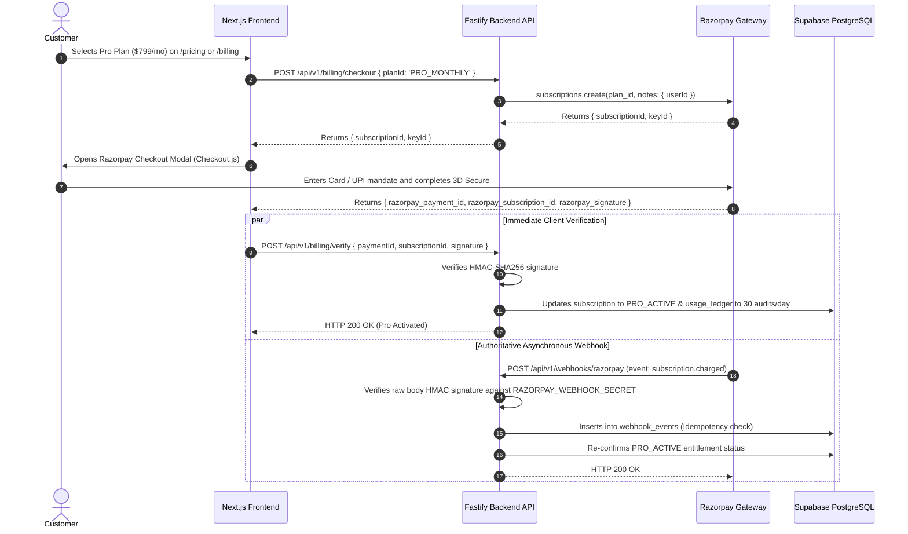

# SiteScope — Payment System Audit & Razorpay Integration Status

**Repository**: `H:\analytics-based-platform`  
**Gateway**: Razorpay Subscriptions (Standard recurring billing in INR / paise)  
**Target Plans**: Free (₹0), Pro Monthly (₹799.00/mo), Pro Yearly (₹7,999.00/yr) + 18% GST  

---

## 1. Payment Workflow Audit Table

| Component | Exists? | Frontend Status | Backend Status | Database Status | Tested? | Notes & Evidence |
| :--- | :--- | :--- | :--- | :--- | :--- | :--- |
| **Pricing Plan Selection** | Yes | **Working** | **Working** (`GET /api/v1/billing/plans`) | `plans` table seeded | Verified | `frontend/src/app/pricing/page.tsx` renders monthly and yearly tiers. |
| **Checkout Initiation** | Yes | **Partially Implemented** | **Implemented** (`POST /api/v1/billing/checkout`) | None (Stateless) | Implemented | Frontend has `handleStartCheckout` fallback simulation; Razorpay Checkout modal SDK script (`checkout.js`) is not yet embedded. |
| **Order / Subscription Creation** | Yes | N/A | **Implemented** | `subscriptions` record | Implemented | Backend uses `razorpay.subscriptions.create({ plan_id, total_count: 120, customer_notify: 1 })`. |
| **Payment Verification** | Yes | N/A | **Implemented** (`POST /api/v1/billing/verify`) | Updates `subscriptions`, `usage_ledger` | Implemented | Verifies HMAC-SHA256 signature using `crypto.timingSafeEqual`. |
| **Webhook Signature Verification** | Yes | N/A | **Complete & Verified** | `webhook_events` | Implemented | Uses Fastify `rawBody` Buffer and `crypto.timingSafeEqual` with `RAZORPAY_WEBHOOK_SECRET`. |
| **Webhook Event Handling** | Yes | N/A | **Implemented** (`subscription.charged`, `payment.captured`, `payment.failed`) | Updates `subscriptions`, `usage_ledger` | Implemented | Activates Pro tier on charged; triggers 7-day grace period on payment failure. |
| **Idempotency & Deduplication** | Yes | N/A | **Implemented** | UNIQUE (`provider`, `provider_event_id`) | Implemented | Database enforces unique constraint; duplicates return HTTP 200 safely. |
| **Entitlement Upgrade** | Yes | N/A | **Implemented** (`upgradeUserEntitlement`) | `subscriptions.entitlement_status = 'PRO_ACTIVE'`, `max_daily_audits = 30` | Implemented | Increases quota from 3 to 30 audits/day in `usage_ledger`. |
| **7-Day Grace Period** | Yes | **Working** banner in UI | **Implemented** in webhooks | `entitlement_status = 'GRACE_PERIOD'` | Implemented | Warning banner in `frontend/src/app/billing/page.tsx` notifies user of payment renewal failure. |
| **Invoice PDF Generation** | No | Static table row | Missing backend generator | Schema field exists (`pdf_object_key`) | Unimplemented | Static invoice row rendered in `billing/page.tsx`; PDF document generation and B2 upload not yet wired. |

---

## 2. End-to-End Payment Lifecycle Trace

---

## 3. Gaps & Pending Implementation Steps

1. **Frontend Razorpay Script Integration**:
   - Add `<Script src="https://checkout.razorpay.com/v1/checkout.js" />` in `frontend/src/app/layout.tsx` or dynamically load it on `/billing` and `/pricing`.
   - Wire the options object (`key`, `subscription_id`, `name`, `prefill`, `handler`) to pop up the real gateway modal in browser.
2. **Environment Configuration**:
   - Project owner must configure `RAZORPAY_KEY_ID`, `RAZORPAY_KEY_SECRET`, `RAZORPAY_WEBHOOK_SECRET`, `RAZORPAY_PLAN_PRO_MONTHLY`, `RAZORPAY_PLAN_PRO_YEARLY` in backend `.env`.
   - Configure `NEXT_PUBLIC_RAZORPAY_KEY_ID` in frontend `.env`.
3. **Automated Invoice PDF Generation**:
   - Implement PDF generation service (using `@react-pdf/renderer` or `pdfkit`) to generate official GST tax invoices for Indian compliance and upload to Backblaze B2.
