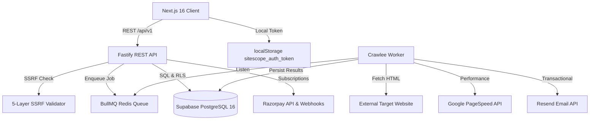

# SiteScope — Project Feature Matrix

**Repository**: `H:\analytics-based-platform`  
**Audit Timestamp**: 2026-10-29T10:35:00+05:30  
**Auditor**: Senior Full-Stack Architect & Code Auditor  

---

## 1. Feature Implementation Matrix

| Feature / Capability | Category | Implementation Status | Frontend Code Location | Backend / Worker Location | Database Backing | Notes & Evidence |
| :--- | :--- | :--- | :--- | :--- | :--- | :--- |
| **Landing & Marketing Pages** | Frontend | **Complete & Verified** | `frontend/src/app/page.tsx`, `features/page.tsx`, `pricing/page.tsx`, `docs/page.tsx` | N/A | None (Static) | 100% prerendered with Next.js Turbopack, responsive CSS modules, zero Tailwind dependency. |
| **Legal & Policy Pages** | Frontend / Legal | **Complete & Verified** | `frontend/src/app/privacy/page.tsx`, `terms/page.tsx`, `acceptable-use/page.tsx`, `refund-policy/page.tsx`, `contact/page.tsx` | N/A | None (Static) | Fully written statutory terms, refund policies (GST compliant), privacy policies, and contact cards. |
| **Website & Project Management** | Core Application | **Complete & Verified** | `frontend/src/app/projects/page.tsx` | `backend/src/routes/projects.ts` | `projects`, `domain_verifications` | Type-safe form, domain SSRF pre-flight validation, handles duplicates (PostgreSQL 23505), dynamic listing. |
| **Audit Triggering & Enqueueing** | Core Application | **Complete & Verified** | `frontend/src/app/projects/page.tsx` (`handleRunAudit`) | `backend/src/routes/audits.ts` (`POST /api/v1/audits`) | `audit_jobs`, `usage_ledger`, `audit_job_outbox` | Enforces ownership check, target SSRF check, atomic quota reservation via PostgreSQL function, BullMQ enqueueing. |
| **Cheerio Crawler Engine** | Worker / Crawler | **Complete & Verified** | N/A | `worker/src/crawlers/cheerio.ts` | `crawled_pages`, `extracted_links` | Real Crawlee CheerioCrawler with origin-bounding, max depth, HTML metadata parsing, link extraction, 404 detection. |
| **5-Layer SSRF Defense Gateway** | Security | **Complete & Verified** | N/A | `backend/src/services/ssrf.ts`, `worker/src/security/ssrf.ts` | N/A | Protocol whitelist (HTTP/HTTPS), DNS resolution, loopback/RFC 1918/cloud metadata blocklist, port filtering. Tested and verified. |
| **Google PageSpeed & Vitals** | Analytics / Worker | **Complete & Verified** | `frontend/src/app/audits/[auditId]/page.tsx` | `worker/src/services/pagespeed.ts` | `performance_metrics` | Core Web Vitals (LCP, INP, CLS, FCP) parser with Google PSI REST API v5 and fallback to local lab emulation. |
| **Mathematical Scoring Engine** | Rules / Scoring | **Complete & Verified** | N/A | `worker/src/processors/scoring.ts`, `worker/src/processors/seo-rules.ts` | `issues`, `audit_summaries` | Weighted composite score: SEO (35%), Performance (25%), Technical Health (25%), Security (15%). Logarithmic penalty damping. |
| **Live Audit Diagnostics Viewer** | Core Application | **Complete & Verified** | `frontend/src/app/audits/[auditId]/page.tsx` | `backend/src/routes/audits.ts` | `audit_jobs`, `crawled_pages`, `issues` | Polling state tracker, 3 tabs (Pages, Issues, Performance), CSV export, responsive table pagination. |
| **Overview Analytics Dashboard** | Core Application | **Complete & Verified** | `frontend/src/app/dashboard/page.tsx` | `backend/src/routes/dashboard.ts` | `audit_summaries`, `usage_ledger` | KPI scorecards, project switcher, Recharts ScoreTrendChart, SeverityBarChart, RecentAuditsTable. |
| **Transactional Email Alerts** | Notifications | **Complete & Verified** | N/A | `worker/src/services/notifications.ts` | `notifications` | Resend API integration with responsive HTML templates for audit completion and critical security findings. Safe dev mode. |
| **Email/Password Auth** | Authentication | **Placeholder / Mock Only** | `frontend/src/app/login/page.tsx`, `register/page.tsx` | `backend/src/middleware/auth.ts` | `auth.users` | Frontend uses `setTimeout` mocks. Backend uses `dev-token` bypass. No real password hashing, registration, or reset. |
| **Google OAuth Authentication** | Authentication | **Missing** | N/A | `backend/.env.example` has references (`GOOGLE_CLIENT_ID`) | `auth.users` | No Google OAuth client flow, redirect handlers, token exchange, or callback pages exist in application code. |
| **Subscription & Quota Management** | Billing | **Partially Implemented** | `frontend/src/app/billing/page.tsx` | `backend/src/routes/billing.ts`, `backend/src/services/billing.ts` | `plans`, `subscriptions`, `usage_ledger`, `payments`, `webhook_events` | Backend has Razorpay subscription creation, webhook verification, and entitlement upgrading. Frontend has test-mode mock fallback; Checkout.js modal is missing. |
| **Webhook Processing** | Billing / Webhooks | **Complete & Verified** | N/A | `backend/src/routes/webhooks.ts` | `webhook_events`, `subscriptions`, `usage_ledger` | Raw body HMAC-SHA256 signature verification, idempotency handling via provider_event_id, 7-day grace period on failure. |
| **Invoice PDF Generation** | Billing | **Planned / Unimplemented** | `frontend/src/app/billing/page.tsx` (static table) | Referenced in schema (`pdf_object_key`) | `billing_invoices` | Schema exists with invoice numbers, amounts, GST; PDF generation engine (e.g. PDFKit/Puppeteer) is not implemented. |
| **Scheduled Audits & Crons** | Background Worker | **Planned / Unimplemented** | `DashboardSidebar.tsx` (placeholder) | Schema exists | `scheduled_audits` | Schema and table definition exist in PostgreSQL; cron scheduler daemon (e.g. node-cron or BullMQ repeat) not yet attached. |
| **Google Analytics 4 & GSC Sync** | Integrations | **Planned / Unimplemented** | Mentioned in landing page marketing copy | Schema exists | `analytics_connections`, `analytics_snapshots` | Table definitions and cryptographic token fields exist; OAuth handshake and sync worker jobs are not yet implemented. |
| **White-Label PDF Reports** | Reporting | **Planned / Unimplemented** | `frontend/src/app/audits/[auditId]/page.tsx` has CSV export | Schema exists | `reports` | CSV client-side export is implemented and working; backend PDF generation to Backblaze B2 is planned. |

---

## 2. Component Dependency Graph

