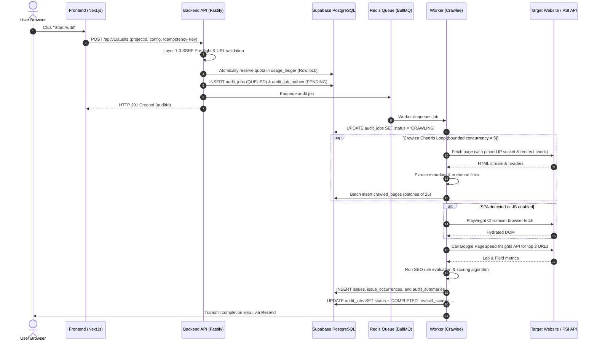

# SiteScope — System Architecture & Monorepo Topology

## 1. Monorepo Organization & Boundaries

SiteScope is structured as a modular TypeScript monorepo with strict architectural boundaries:

```text
sitescope/
├── frontend/                  # Next.js 16 + TypeScript (Port 3000)
│   ├── src/app/               # App Router pages (Dashboard, Projects, Billing)
│   ├── src/components/        # Reusable UI widgets, Recharts, TanStack Tables
│   ├── src/styles/            # CSS Modules & design system tokens (NO Tailwind)
│   ├── package.json
│   └── README.md
│
├── backend/                   # Fastify REST API (Port 4000)
│   ├── src/routes/            # REST API route controllers (/api/v1/*)
│   ├── src/services/          # Business logic, billing, OAuth, rate limiting
│   ├── src/plugins/           # Fastify plugins (CORS, JWT, Redis, RawBody)
│   ├── src/schemas/           # Fastify/TypeBox/Zod validation schemas
│   ├── src/app.ts             # Application bootstrapping
│   ├── tests/                 # Unit & integration tests
│   ├── package.json
│   └── README.md
│
├── worker/                    # Background Jobs & Crawling
│   ├── src/crawlers/          # Crawlee CheerioCrawler & Playwright engines
│   ├── src/jobs/              # BullMQ queue processors (Crawl, PDF, Reconcile)
│   ├── src/processors/        # SEO rule analyzer, PSI API client, scoring engine
│   ├── tests/                 # Mock crawler target tests, SSRF tests
│   ├── package.json
│   └── README.md
│
├── database/                  # Supabase PostgreSQL Assets
│   ├── migrations/            # Version-controlled SQL migration files
│   ├── seeds/                 # Local development test fixtures
│   ├── policies/              # Row-Level Security (RLS) rules
│   ├── tests/                 # pgTAP / RLS isolation test scripts
│   └── README.md
│
├── shared/                    # Shared Types & Contracts
│   ├── types/                 # Shared TypeScript interfaces (Audit, Issues, User)
│   ├── schemas/               # Shared validation contracts
│   └── package.json
│
├── docs/                      # Technical specifications & guides
├── scripts/                   # Safe maintenance & setup scripts
├── IMPLEMENTATION_STATUS.md   # Ground-truth project status ledger
└── package.json               # Root workspace orchestration
```

---

## 2. End-to-End Audit Sequence Diagram


