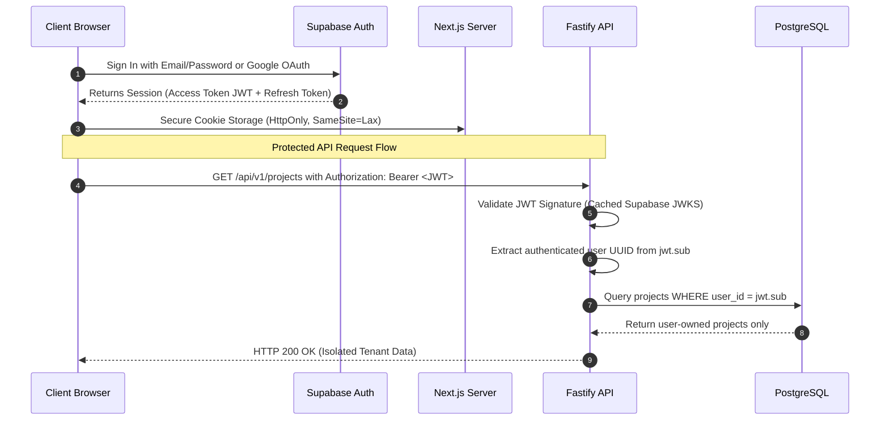

# SiteScope — Authentication Architecture & Tenant Isolation

## 1. Executive Summary & Identity Stack

SiteScope utilizes **Supabase Auth** as its primary identity provider (IdP). Authentication is enforced across three architectural layers:
1. **Frontend (Next.js)**: Manages session cookies, client-side route guards, login/signup forms, and Google OAuth redirects using `@supabase/ssr`.
2. **Backend (Fastify REST API)**: Validates incoming Bearer JWT access tokens on every protected endpoint using Supabase's JWKS (JSON Web Key Set). Enforces tenant and project ownership independently of client claims.
3. **Database (Supabase PostgreSQL)**: Enforces Row-Level Security (RLS) policies mapping `auth.uid() = user_id` for direct database access, while granting elevated rights only via the backend service role.

**Zero-Trust Identity Rule**:
The Fastify backend **never trusts a client-supplied `userId` or `role` parameter**. The user identity is extracted exclusively from the cryptographically verified JWT payload (`token.sub`).

---

## 2. Authentication Flow Diagram



---

## 3. Database Security & Row-Level Security (RLS)

All multi-tenant tables in SiteScope enforce RLS. Even if an attacker executes raw SQL or accesses PostgREST, they cannot view records belonging to another tenant.

### Exemplary RLS Policies:
```sql
-- Enable RLS on all sensitive tables
ALTER TABLE projects ENABLE ROW LEVEL SECURITY;
ALTER TABLE audit_jobs ENABLE ROW LEVEL SECURITY;
ALTER TABLE issues ENABLE ROW LEVEL SECURITY;
ALTER TABLE reports ENABLE ROW LEVEL SECURITY;
ALTER TABLE subscriptions ENABLE ROW LEVEL SECURITY;

-- Projects: Only project owners can view or modify their projects
CREATE POLICY "Users can access their own projects"
    ON projects
    FOR ALL
    USING (auth.uid() = user_id)
    WITH CHECK (auth.uid() = user_id);

-- Audit Jobs: Enforce ownership via project hierarchy
CREATE POLICY "Users can access audit jobs for their projects"
    ON audit_jobs
    FOR ALL
    USING (
        project_id IN (
            SELECT id FROM projects WHERE user_id = auth.uid()
        )
    );

-- Issues: Read-only access to issues belonging to user projects
CREATE POLICY "Users can view findings for their projects"
    ON issues
    FOR SELECT
    USING (
        project_id IN (
            SELECT id FROM projects WHERE user_id = auth.uid()
        )
    );
```

---

## 4. Service-Role Credential Confinement

- **Public Client Key (`NEXT_PUBLIC_SUPABASE_ANON_KEY`)**: Distributed to the browser; has strictly restricted privileges bound by RLS.
- **Service-Role Key (`SUPABASE_SERVICE_ROLE_KEY`)**:
  - Strictly confined to `backend/.env` and `worker/.env`.
  - **Never bundled into Next.js client builds or exposed to the public internet**.
  - Bypasses RLS to allow background workers to ingest crawl results and payment reconcilers to update subscriber entitlements.
