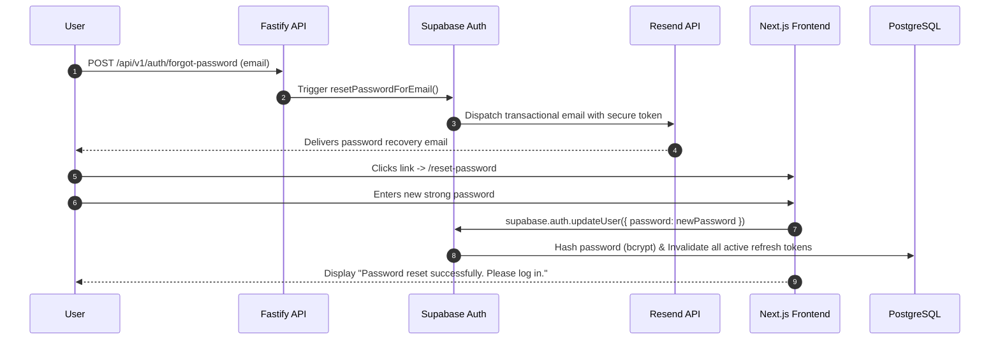

# SiteScope — Authentication Recovery & Account Enumeration Defense

## 1. Zero-Information Leakage Policy

To protect customer privacy, public-facing authentication endpoints must never reveal whether a given email address is registered in SiteScope.

### Anti-Enumeration Rules:
1. **Password Reset (`POST /api/v1/auth/forgot-password`)**:
   - Always returns `HTTP 200 OK` with payload:
     ```json
     {
       "success": true,
       "message": "If an account is associated with this email address, a password reset link has been dispatched."
     }
     ```
   - Execution timing is equalized with jitter to prevent side-channel timing attacks that distinguish existing from non-existing accounts.
2. **Registration (`POST /api/v1/auth/signup`)**:
   - If an account already exists with the submitted email, Supabase Auth does not return an error revealing the account. Instead, it re-transmits an email notification: `"An account creation attempt was made with this email. If this was you, please sign in."`

---

## 2. Password Recovery Lifecycle



---

## 3. Recovery Token Constraints

- **Expiry Window**: Password reset tokens expire **60 minutes** after generation.
- **Single-Use**: Once a token is submitted to update the password, it is immediately invalidated.
- **Session Revocation**: Changing the password immediately terminates all active web sessions across all browsers and devices.
