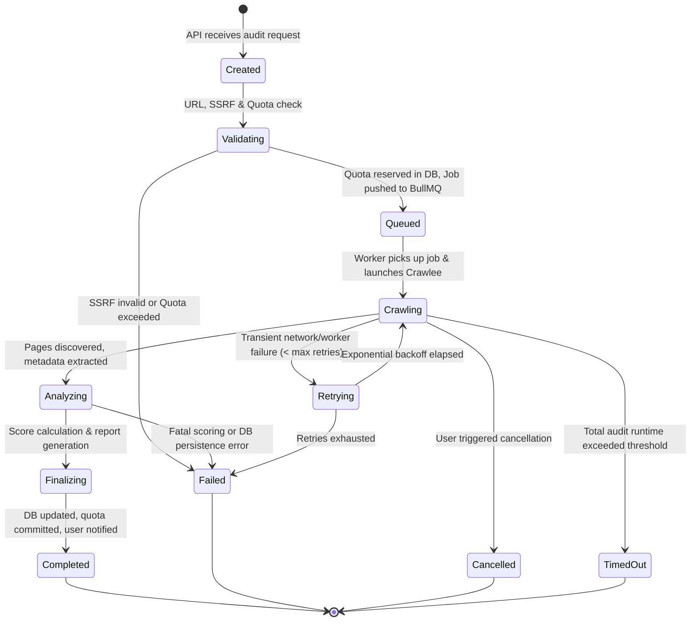

# SiteScope — Crawler Job Lifecycle & Coordination

## 1. Overview & Durable State Principle

Website audits in SiteScope are long-running, asynchronous operations that cannot run inside HTTP request handlers. The audit lifecycle coordinates three durable and transient components:
1. **PostgreSQL (Supabase)**: The authoritative durable source of truth for job state, atomic quota reservations, discovered page records, findings, summaries, and issue histories.
2. **Redis & BullMQ (Render Key Value)**: Transient job queue for distribution, concurrency management, delayed retries, and worker process coordination.
3. **Background Worker (Render Worker)**: Stateless worker process executing Crawlee, Lighthouse/PageSpeed API calls, scoring calculations, and report artifact uploads.

Worker memory or Redis queues are never treated as durable storage. If Redis crashes or a worker is killed via SIGTERM/SIGKILL, PostgreSQL retains the complete progress state, allowing deterministic job recovery or safe quota reversal.

---

## 2. Complete Job State Machine



### Valid Status Transitions
| From Status | To Status | Trigger / Condition | Side Effects |
| :--- | :--- | :--- | :--- |
| `CREATED` | `VALIDATING` | API starts validation routine | Validate URL syntax, domain ownership, and scheme |
| `VALIDATING` | `QUEUED` | SSRF & pre-flight pass, quota available | Atomically decrement daily audit quota in `usage_ledger`; enqueue in BullMQ |
| `VALIDATING` | `FAILED` | SSRF violation, unresolvable host, quota limit reached | Record failure reason; zero quota consumed |
| `QUEUED` | `CRAWLING` | Worker acquires job lock from BullMQ | Set `started_at` timestamp; update worker heartbeat |
| `CRAWLING` | `ANALYZING` | Crawlee finishes discovered URLs or hits page limit | Aggregate raw pages, initiate SEO rule checks & PSI API |
| `ANALYZING` | `FINALIZING` | SEO findings & PSI metrics computed | Run scoring algorithm; generate summary row; trigger PDF/CSV task if requested |
| `FINALIZING` | `COMPLETED` | PostgreSQL summary committed, artifacts stored | Mark quota consumption finalized; send email notification if enabled |
| `CRAWLING` | `RETRYING` | Network disruption or unhandled worker exception | Increment retry count; release partial resources |
| `RETRYING` | `CRAWLING` | Backoff delay expires | Resume crawl from persisted checkpoint if possible |
| `*` (Any active) | `CANCELLED` | User clicks "Cancel Audit" | Worker aborts Crawlee queue immediately; calculate partial score or refund quota |
| `*` (Any active) | `TIMED_OUT` | Execution exceeds max wall-clock time (30 min) | Worker gracefully finalizes discovered pages; flags audit as partial |
| `*` (Any active) | `FAILED` | Fatal unrecoverable error | Log error; release reserved quota according to refund policy |

---

## 3. Atomic Quota Reservation Protocol

To prevent race conditions where a user initiates concurrent audits across multiple browser tabs to bypass their daily plan quota (e.g., Free plan limit: 3 audits/day):

1. **Database Transaction**:
   ```sql
   -- Conceptual atomic reservation inside a single transaction
   BEGIN;
   SELECT current_audits_count, max_daily_audits 
   FROM usage_ledger 
   WHERE user_id = $1 AND period_date = CURRENT_DATE 
   FOR UPDATE; -- Row-level lock prevents concurrent bypass

   -- Check if quota is available
   IF current_audits_count >= max_daily_audits THEN
       ROLLBACK;
       RAISE EXCEPTION 'DAILY_AUDIT_QUOTA_EXCEEDED';
   END IF;

   -- Reserve quota tentatively
   UPDATE usage_ledger 
   SET current_audits_count = current_audits_count + 1,
       updated_at = NOW()
   WHERE user_id = $1 AND period_date = CURRENT_DATE;

   -- Create audit job in PostgreSQL with status 'QUEUED'
   INSERT INTO audit_jobs (id, project_id, user_id, status, config, created_at)
   VALUES ($job_id, $project_id, $1, 'QUEUED', $config, NOW());

   COMMIT;
   ```
2. **Quota Reversal on Failure**:
   If an audit job fails during `VALIDATING` or immediately upon first URL fetch due to network unreachability (0 pages crawled), an automated reconciliation query reverses the reservation (`current_audits_count = current_audits_count - 1`) so users are not penalized for failed initial connectivity.

---

## 4. Crash Recovery & Stale Job Reaping

### A. Heartbeat Mechanism
- While crawling, the worker updates the `heartbeat_at` timestamp in `audit_jobs` every **30 seconds**.
- Redis BullMQ job lock is renewed every **15 seconds**.

### B. Stale Job Detector (Scheduler Routine)
A background cron job runs every **5 minutes** in the worker to inspect active jobs:
- If a job has status `CRAWLING` or `ANALYZING` but `heartbeat_at < NOW() - INTERVAL '3 MINUTES'`:
  1. The worker process that was executing the job is presumed dead (e.g. killed by Render deployment or OOM).
  2. If `retry_count < 2`, the job status is set to `RETRYING` and re-pushed to BullMQ.
  3. If `retry_count >= 2`, the job status is marked as `FAILED` with failure reason: `"Worker terminated unexpectedly during crawl. System recovered."`
  4. Quota reservation is released if fewer than 5 pages were processed.

---

## 5. Incremental Result Persistence & Checkpointing

- Rather than buffering thousands of crawled pages in worker RAM and performing a massive bulk insert at the end:
  1. Crawlee persists discovered pages to PostgreSQL in batches of **25 pages** or every **10 seconds**.
  2. Page records include: URL, HTTP status code, response time (ms), title, meta description, canonical tag, robots header, content-length, and heading tags.
  3. Discovered outbound and internal links are inserted into `extracted_links` asynchronously.
- If a crawl is cancelled or times out, all already-crawled pages remain intact in PostgreSQL, allowing SiteScope to display a `"Partial Audit Result"` to the user without losing valuable diagnostic data.
