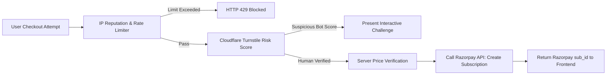

# SiteScope — Fraud Prevention & Financial Security Specification

## 1. Threat Landscape & Risk Controls

Financial endpoints in SaaS platforms are targeted by automated bots, card-testing scripts (carding attacks), and malicious actors attempting to tamper with pricing or bypass subscription mandates.

**Core Defensive Principles**:
1. **Server-Authoritative Pricing**: The client browser **never** transmits amounts or currency codes. The Fastify API accepts only a validated `planId` (e.g. `'PRO_MONTHLY'`) and derives the exact amount (`79900` paise) and tax from trusted server-side configuration.
2. **PCI-DSS Compliance via Delegation**: SiteScope's servers **never receive, process, or store raw Credit/Debit card numbers (PAN), CVVs, or bank netbanking credentials**. All card data entry occurs inside the PCI-DSS Level 1 compliant Razorpay checkout iframe/SDK.
3. **Carding & Bot Defense**: High-frequency checkout generation is throttled, and suspicious traffic requires Cloudflare Turnstile verification.

---

## 2. Multi-Layer Anti-Fraud Defenses

### A. Price Tampering Prevention
- If a client payload submits `{ "planId": "PRO_MONTHLY", "amount": 100 }`, Fastify's schema validator rejects the unexpected property `amount` with `HTTP 400 Bad Request (Additional properties not permitted)`.
- The internal order is created with the exact database plan price:
  - Monthly: `79,900` paise (₹799) + 18% GST (`14,382` paise) = `94,282` paise total.
  - Yearly: `799,900` paise (₹7,999) + 18% GST (`143,982` paise) = `943,882` paise total.

### B. Anti-Carding & Bot Throttling
- Carders use automated scripts to test stolen credit card numbers by spinning up micro-transactions.
- **Controls**:
  1. Maximum 5 checkout creation attempts per 15 minutes per IP address.
  2. Maximum 2 active checkout sessions per user account at any given moment.
  3. Accounts created within the last 10 minutes that immediately trigger checkouts with multiple failed card authorization webhooks are automatically quarantined.

### C. Secret Redaction & Logging Safeguards
- All request and response logs pass through Fastify's centralized redaction pipeline.
- Sensitive fields are strictly scrubbed:
  - `card`, `cvv`, `pan`, `token`, `secret`, `authorization`, `signature`, `password`.
- Webhook payloads stored in `webhook_events` are scrubbed of customer card identifiers beyond standard masked references (e.g., `last4: "4242"`).
