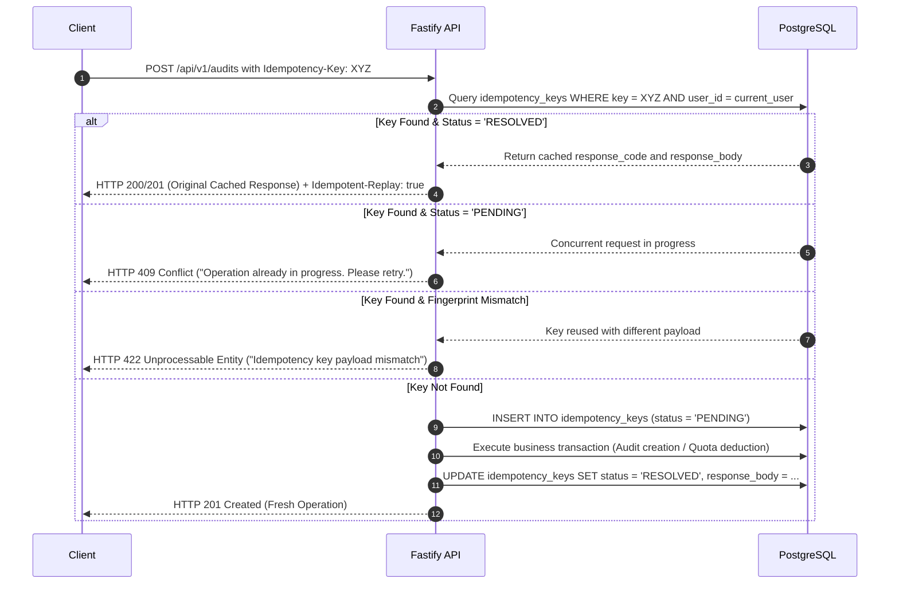

# SiteScope — Idempotency & Request Deduplication Specification

## 1. Objective & Scope

In a distributed SaaS environment, network latency, browser retries, client double-clicks, and automated scripts can dispatch duplicate state-changing requests. 

Operations with costly side effects—such as creating an audit job, generating a PDF report, creating a Razorpay checkout session, or recording a payment—**must be strictly idempotent**.

---

## 2. The `Idempotency-Key` Protocol

SiteScope implements an HTTP header standard for mutation endpoints:
- **Header**: `Idempotency-Key: <UUIDv4>`
- **Scope**: Keys are unique per `(user_id, endpoint, idempotency_key)`.
- **TTL**: Idempotency records are durably retained for **24 hours**.

### Durable Database Schema (`idempotency_keys`)
```sql
CREATE TABLE idempotency_keys (
    id UUID PRIMARY KEY DEFAULT gen_random_uuid(),
    user_id UUID NOT NULL REFERENCES auth.users(id) ON DELETE CASCADE,
    endpoint VARCHAR(255) NOT NULL,
    idempotency_key VARCHAR(128) NOT NULL,
    request_fingerprint CHAR(64) NOT NULL, -- SHA-256(endpoint + payload + user_id)
    status VARCHAR(32) NOT NULL, -- 'PENDING', 'RESOLVED', 'FAILED'
    response_code INTEGER,
    response_body JSONB,
    created_at TIMESTAMPTZ NOT NULL DEFAULT NOW(),
    expires_at TIMESTAMPTZ NOT NULL DEFAULT NOW() + INTERVAL '24 HOURS',
    CONSTRAINT uq_user_endpoint_key UNIQUE (user_id, endpoint, idempotency_key)
);

CREATE INDEX idx_idempotency_lookup ON idempotency_keys (user_id, idempotency_key);
CREATE INDEX idx_idempotency_expiry ON idempotency_keys (expires_at);
```

---

## 3. Request Processing State Machine



---

## 4. Audit & Queue Deduplication (BullMQ)

To prevent users or automated webhooks from queuing multiple concurrent crawls for the exact same project:
1. **Deduplication Key**: When enqueuing a crawl job to BullMQ, the `jobId` is computed deterministically:
   ```typescript
   const auditConfigHash = crypto
     .createHash('sha256')
     .update(JSON.stringify({ projectId, crawlDepth, maxPages, enableJs }))
     .digest('hex');

   const bullMqJobId = `audit:${projectId}:${auditConfigHash}`;
   ```
2. **Active Job Locking**:
   - If a BullMQ job with `bullMqJobId` is already in state `active` or `waiting`, BullMQ rejects the duplicate enqueue call without error.
   - Fastify API detects this and attaches the user's request to the existing active `audit_job_id` instead of spinning up an unnecessary second crawl.

---

## 5. Client-Side Interaction Controls

1. **Form Submission Locking**: Frontend buttons enter a disabled `loading` state immediately upon submission, preventing accidental rapid double-clicks.
2. **Key Retention**: If an operation fails due to network drop before receiving a response, the client-side retry automatically re-uses the original `Idempotency-Key` generated for that action.
3. **Graceful Status Polling**: If an idempotent operation returns `409 Conflict (In Progress)`, the client begins polling the status endpoint `/api/v1/audits/:auditId` rather than re-dispatching POST requests.
