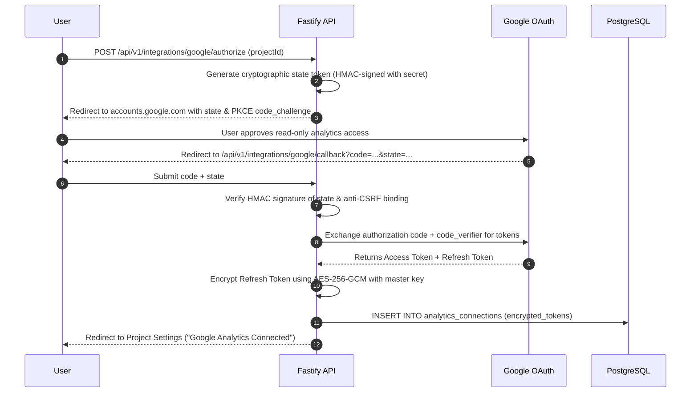

# SiteScope — OAuth Security & Google Integrations Specification

## 1. Absolute Separation of Concerns

**A fundamental security boundary of SiteScope**:
- **Signing in with Google DOES NOT grant access to website analytics**.
- **User Login OAuth** and **Analytics Integration OAuth** use distinct OAuth client configurations, distinct permission scopes, and distinct token lifecycles.

| Dimension | User Authentication OAuth | Analytics & Search Console Integration OAuth |
| :--- | :--- | :--- |
| **Provider / Flow** | Supabase Auth (Sign in with Google) | Custom Fastify Backend OAuth Service |
| **Scopes Requested** | `openid`, `email`, `profile` | `https://www.googleapis.com/auth/analytics.readonly`<br>`https://www.googleapis.com/auth/webmasters.readonly` |
| **Purpose** | Identity verification & account creation | Read-only metric extraction for authorized properties |
| **Token Storage** | Managed internally by Supabase Auth | Stored in PostgreSQL `analytics_connections` encrypted with AES-256-GCM |
| **Revocation Impact** | User is logged out of SiteScope | Only the analytics sync is disconnected; account remains active |

---

## 2. Integration OAuth Security Lifecycle



---

## 3. At-Rest Token Encryption (AES-256-GCM)

Plaintext OAuth refresh tokens are **never stored in the database**.

### Encryption Specification:
1. **Algorithm**: `AES-256-GCM` (Authenticated Encryption with Associated Data).
2. **Master Key**: 256-bit secret loaded from environment variable `ENCRYPTION_MASTER_KEY` (64 hex characters).
3. **Initialization Vector (IV)**: A unique, cryptographically random 12-byte IV is generated for every encryption operation.
4. **Storage Format**:
   ```sql
   CREATE TABLE analytics_connections (
       id UUID PRIMARY KEY DEFAULT gen_random_uuid(),
       project_id UUID NOT NULL REFERENCES projects(id) ON DELETE CASCADE,
       user_id UUID NOT NULL REFERENCES auth.users(id),
       provider VARCHAR(32) NOT NULL, -- 'google_analytics_4', 'google_search_console'
       property_id VARCHAR(128) NOT NULL,
       property_name VARCHAR(255) NOT NULL,
       encrypted_refresh_token BYTEA NOT NULL,
       encryption_iv BYTEA NOT NULL,
       encryption_auth_tag BYTEA NOT NULL,
       access_token_expires_at TIMESTAMPTZ,
       last_synced_at TIMESTAMPTZ,
       created_at TIMESTAMPTZ NOT NULL DEFAULT NOW(),
       CONSTRAINT uq_project_provider UNIQUE (project_id, provider)
   );
   ```
5. **Decryption on Demand**: The background sync worker decrypts the refresh token only in volatile process memory for the immediate duration of calling Google APIs, and immediately wipes the buffer.
