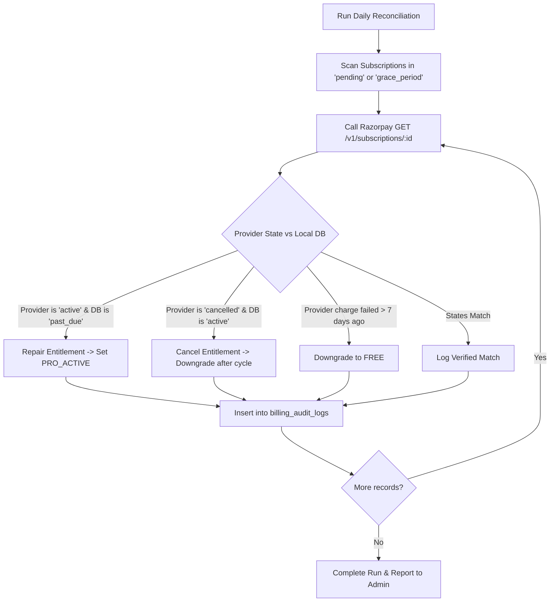

# SiteScope — Payment Reconciliation & Entitlement Repair

## 1. Objective & Operational Mandate

Even with robust webhooks, edge cases (network partitions, provider outages, unhandled runtime crashes) can cause discrepancies between Razorpay's actual financial state and SiteScope's local database.

The **Payment Reconciliation Worker** runs as an autonomous, scheduled background job to:
1. Reconcile pending or ambiguous subscriptions against Razorpay's REST API.
2. Repair orphaned entitlements (e.g. user was charged successfully by Razorpay, but webhook failed to activate Pro).
3. Detect anomalous double-charges or duplicate subscriptions.
4. Ensure financial auditability before issuing tax invoices.

---

## 2. Reconciliation Routine Schedule

- **Frequency**: Every day at **02:00 AM UTC** (Low-traffic window) + on-demand via role-protected Admin Panel.
- **Queue**: `reconciliation-queue` with concurrency = 1 (Strictly sequential to avoid race conditions).

### Query Targets:
1. All subscriptions in state `pending`, `past_due`, or `grace_period`.
2. All payment operations in state `PENDING` created more than **15 minutes ago**.
3. All webhook events with status `FAILED`.

---

## 3. Reconciliation Logic Flow



---

## 4. Audit Trail & Human Escalation

Every automated repair or state adjustment generates an immutable record in `billing_audit_logs`:
```sql
CREATE TABLE billing_audit_logs (
    id UUID PRIMARY KEY DEFAULT gen_random_uuid(),
    user_id UUID REFERENCES auth.users(id),
    subscription_id VARCHAR(128),
    payment_id VARCHAR(128),
    action VARCHAR(64) NOT NULL, -- e.g. 'RECONCILIATION_ENTITLEMENT_REPAIRED'
    previous_state JSONB NOT NULL,
    new_state JSONB NOT NULL,
    performed_by VARCHAR(64) NOT NULL, -- 'SYSTEM_RECONCILER' or Admin User UUID
    reason TEXT NOT NULL,
    created_at TIMESTAMPTZ NOT NULL DEFAULT NOW()
);
```

**Human Escalation Rule**:
If a user was charged multiple times for the same billing cycle (detected via multiple captured payments with overlapping `billing_period_start` and `billing_period_end`), the reconciler:
1. Flags the account with `MANUAL_REVIEW_REQUIRED`.
2. Does **not** execute automated charge cancellations without human verification.
3. Transmits an alert to the engineering team via Resend admin notification.
