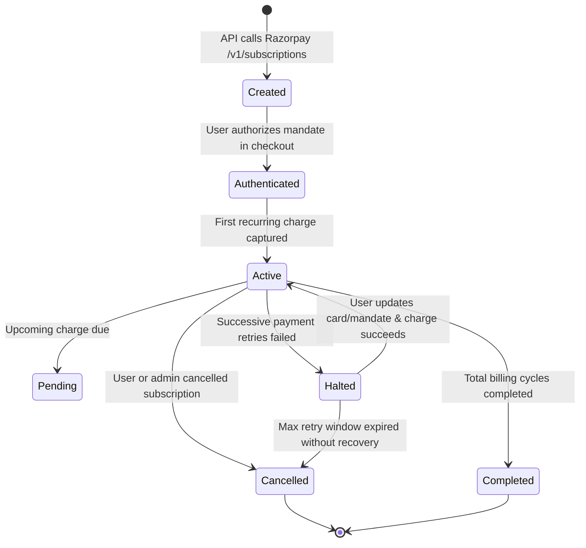

# SiteScope — Payment State Machine & Subscription Lifecycle

## 1. Executive Summary & Core Rules

SiteScope uses **Razorpay Subscriptions** for recurring billing. 

**Absolute Financial Rules**:
1. **Frontend redirects or callbacks never grant entitlement**. Only backend-verified cryptographic signatures or authoritative webhook events update billing state.
2. **Currency Unit**: Stored strictly in integer **paise** (`₹1 = 100 paise`). Floating-point arithmetic is prohibited.
   - Monthly Pro Plan: **₹799 + taxes = 79,900 paise**
   - Yearly Pro Plan: **₹7,999 + taxes = 799,900 paise**
3. **Decoupled States**: The external provider subscription state is stored separately from the internal application entitlement state.

---

## 2. Decoupled Multi-Entity Architecture

SiteScope maintains distinct database entities to prevent state collapse:
1. `payment_operations`: Transient client checkout requests and idempotency tokens.
2. `subscriptions`: Razorpay subscription entity lifecycle.
3. `payments`: Individual recurring debit charges, authorized payments, or failed debits.
4. `billing_invoices`: Auditable tax invoices with distinct subtotal, GST tax, and total.
5. `user_entitlements`: Internal feature gates and quotas (Free vs Pro).

---

## 3. Subscription & Entitlement State Machines

### A. Razorpay Subscription Lifecycle

### B. Application Entitlement Lifecycle (With 7-Day Grace Period)

```mermaid
stateDiagram-v2
    [*] --> Free: Default account creation
    Free --> ProActive: Verified payment receipt / subscription active
    ProActive --> GracePeriod: Payment failed at renewal (7 Calendar Days)
    GracePeriod --> ProActive: Payment recovered within 7 days
    GracePeriod --> Downgraded: 7 days expired without payment recovery
    ProActive --> CancellationPending: User cancelled; remains active until cycle end
    CancellationPending --> Downgraded: Billing period reaches end date
    Downgraded --> Free: Plan limits reset to Free tier
```

---

## 4. State Matrix & Feature Entitlements

| Entitlement State | Monitored Projects | Pages / Audit | Daily Audits | Performance URLs | PDF Reports | Scheduled Audits |
| :--- | :--- | :--- | :--- | :--- | :--- | :--- |
| **`FREE`** | 1 | 50 | 3 | 0 | Limited | No |
| **`PRO_ACTIVE`** | 10 | 1,000 | 30 | 3 | Full PDF/CSV | Daily/Weekly/Monthly |
| **`GRACE_PERIOD`** | 10 | 1,000 | 30 | 3 | Full PDF/CSV | Daily/Weekly/Monthly |
| **`CANCELLATION_PENDING`** | 10 | 1,000 | 30 | 3 | Full PDF/CSV | Daily/Weekly/Monthly |
| **`DOWNGRADED`** | 1 (Active) + 9 (Archived) | 50 | 3 | 0 | Limited | Paused |

### Downgrade Project Handling Rule:
When a Pro account downgrades to Free, existing projects are **never deleted**. The most recently active project remains accessible; surplus projects (up to 9) transition to `ARCHIVED` status (read-only historical audit data, crawling disabled) until the user upgrades to Pro again.
