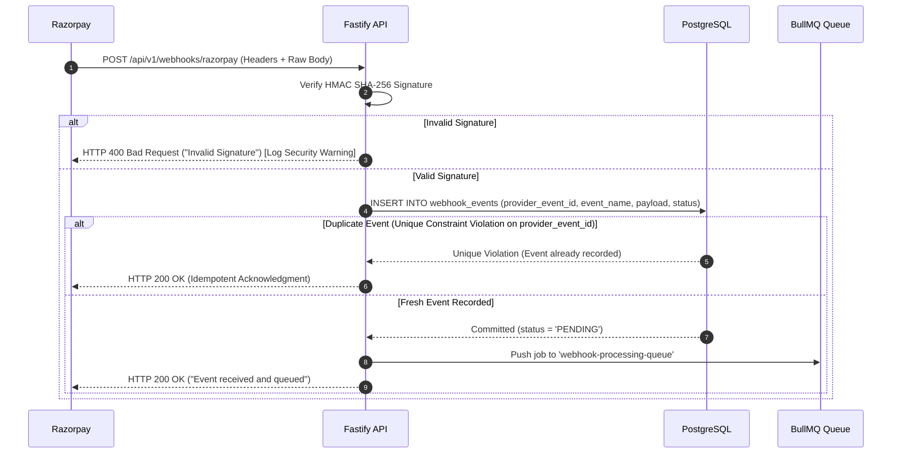

# SiteScope — Webhook Reliability & Event Processing

## 1. Executive Summary & Zero-Trust Verification

Razorpay webhooks are the authoritative delivery mechanism for subscription renewals, payment captures, failed debits, cancellations, and refunds.

**Webhook Security Imperatives**:
1. **Raw Body Verification**: Fastify registers a custom content parser (`addContentTypeParser('application/json')`) to retain the unmodified `rawBody` Buffer. Signatures cannot be verified against re-serialized JSON.
2. **HMAC SHA-256**: Signatures are computed as `crypto.createHmac('sha256', secret).update(rawBody).digest('hex')` and compared with `x-razorpay-signature` using timing-safe comparison (`crypto.timingSafeEqual`).
3. **Persist First, Process Second**: Webhooks are durably stored in PostgreSQL before acknowledging with `HTTP 200 OK`. Long-running business processing never executes during the HTTP request.

---

## 2. Webhook Event Ingestion Flow



---

## 3. Database Schema (`webhook_events`)

```sql
CREATE TABLE webhook_events (
    id UUID PRIMARY KEY DEFAULT gen_random_uuid(),
    provider VARCHAR(32) NOT NULL DEFAULT 'razorpay',
    provider_event_id VARCHAR(128) NOT NULL, -- e.g. 'event_ABC123xyz'
    event_name VARCHAR(128) NOT NULL, -- e.g. 'subscription.charged'
    payload JSONB NOT NULL,
    status VARCHAR(32) NOT NULL DEFAULT 'PENDING', -- 'PENDING', 'PROCESSED', 'FAILED', 'IGNORED'
    attempts INTEGER NOT NULL DEFAULT 0,
    last_error TEXT,
    processed_at TIMESTAMPTZ,
    created_at TIMESTAMPTZ NOT NULL DEFAULT NOW(),
    CONSTRAINT uq_provider_event UNIQUE (provider, provider_event_id)
);

CREATE INDEX idx_webhook_status_created ON webhook_events (status, created_at);
```

---

## 4. Handling Out-of-Order & Duplicate Events

In distributed networks, webhooks may arrive out of order (e.g., `subscription.cancelled` arriving before `subscription.charged`).

### Event Timestamp Ordering
Each Razorpay event contains an authoritative Unix timestamp: `event.created_at`.
1. Before updating `subscriptions` or `user_entitlements`, the worker compares the incoming event timestamp with the last recorded `event_timestamp` in the database.
2. If `incoming_event_timestamp < last_recorded_timestamp`, the event is flagged as `OUT_OF_ORDER`. It records the audit event but **does not overwrite the newer state**.
3. If the event sequence is ambiguous, the worker calls the Razorpay REST API `/v1/subscriptions/:id` directly to fetch the authoritative ground truth before applying mutations.
